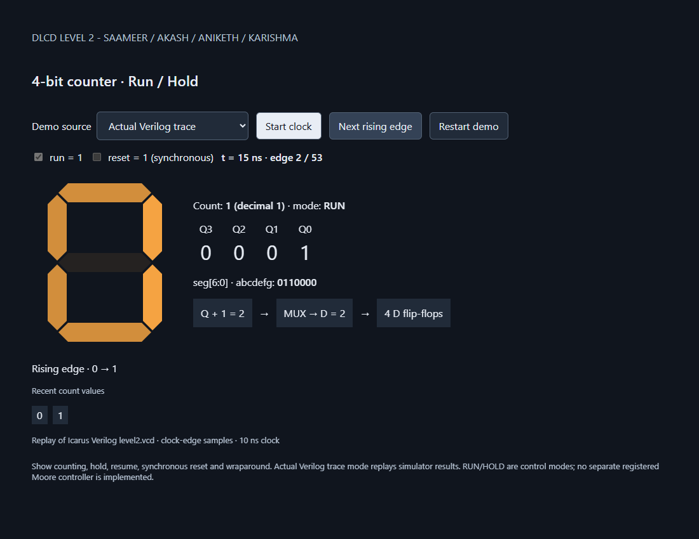
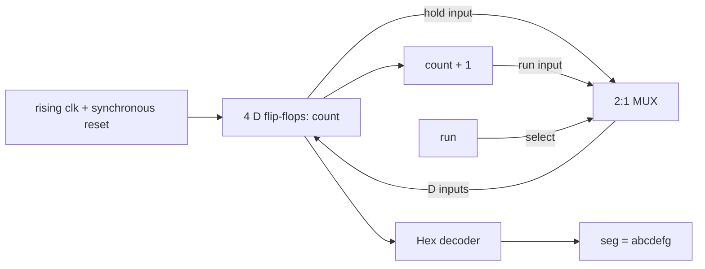

# DLCD Level 2 · Counter lab

**A 4-bit run/hold counter, a hexadecimal display, and a visual explanation of the circuit.**

[](https://github.com/Akash-1271/dlcd-level2-counter/actions/workflows/verify.yml)

**Team:** Saameer · Akash · Aniketh · Karishma

## Open the simulation

### [Download the visual simulation](https://github.com/Akash-1271/dlcd-level2-counter/releases/download/v1.0.0/counter-simulation.html)

**Download → double-click `counter-simulation.html` → Start clock.** It opens in Chrome or Edge and works offline. No installation, terminal or PPT is needed. Press F11 for full screen.

Use **Run/Hold**, **Reset** and **Next rising edge** to demonstrate the circuit. Select **Actual Verilog trace** to replay the verified simulation. The interactive mode models the circuit behavior; trace mode replays recorded Verilog output.

This is a private repository: sign in with an account that has access to download the simulation. GitHub displays HTML source rather than running it inside repository pages.



## Start here

| You want to… | Open this |
| --- | --- |
| Run the simulation without installing anything | [Download the ready-to-open HTML](https://github.com/Akash-1271/dlcd-level2-counter/releases/download/v1.0.0/counter-simulation.html), then double-click it |
| Understand the circuit and signals | [Design, diagrams and truth tables](docs/DESIGN.md) |
| Prepare the group demonstration | [Presentation guide and team roles](docs/PRESENTATION-GUIDE.md) |
| See saved results | [Simulation log](evidence/simulation.log) and [VCD waveform](evidence/level2.vcd) |
| Make a change | [Team workflow](CONTRIBUTING.md) |

GitHub shows HTML source; download/extract the repo before opening the demo. It works offline. Press F11 for presentation mode.

## What it does

At each rising clock edge, reset clears the counter. Otherwise `run=1` increments it and `run=0` holds the current value. Four-bit arithmetic wraps **F → 0**. A combinational decoder drives the seven-segment display.



| reset | run | Count after the rising edge |
| :---: | :---: | --- |
| 1 | Either | 0 |
| 0 | 0 | Same value |
| 0 | 1 | Current value + 1, modulo 16 |

`seg[6:0] = {a,b,c,d,e,f,g}`; a `1` lights a segment. Letter glyphs are A, b, C, d, E and F.

## Two demonstration modes

**Interactive behavior model:** use Start clock, Run/Hold, synchronous Reset and Next rising edge. Watch the display, four bits and selected MUX data change.

**Actual Verilog trace:** replays 53 clock-edge snapshots recorded by Icarus Verilog. It does not run Verilog in the browser. CI checks the embedded recording against a fresh simulation. After RTL changes, regenerate it with `python scripts/sync_demo_trace.py`.

## Run the simulation

Install **Python 3** and **Icarus Verilog** (`iverilog` and `vvp`). Put Icarus on PATH; the runner also detects `C:/iverilog/bin` on Windows. GTKWave is optional.

From the repository root:

```sh
python scripts/verify.py
python scripts/sync_demo_trace.py --check
```

On Windows use `py` instead of `python` if needed. These commands do not require enabling PowerShell scripts. Outputs go into `build/`.

Expected summaries:

```text
PASS: 53 edge checks, 104 between-edge checks, 16/16 decoder patterns,
      all 16 counts, 2 wraps; run=39 hold=11 reset=3
PASS: exhaustive recheck of all 64 combinations of count[3:0], reset and run,
      including off-edge stability.
```

View the waveform:

```sh
gtkwave build/level2.vcd
```

Append clk, reset, run, count and seg from tb_level2. Display count as hexadecimal and seg as binary. Inspect **60–120 ns** for HOLD at 5, **125 ns** for resume to 6, **130–135 ns** for synchronous reset, and **315 ns** for F → 0 wraparound.

## Important assignment interpretation

The problem asks for a **two-state Moore controller**, while also specifying a MUX controlled directly by the current `run` input. This implementation follows the direct MUX and immediate edge behavior. **It has no separate registered RUN/HOLD controller.** The diagram represents control modes; the stored state is the four-bit count.

This is a known assignment-compliance question that passing tests cannot settle. Confirm the interpretation with the instructor before treating the submission as fully compliant. See [DESIGN.md](docs/DESIGN.md).

## Repository map

```text
rtl/        Counter, decoder and top-level Verilog
tb/         Main testbench and exhaustive transition recheck
demo/       Offline display and recorded Verilog playback
docs/       Learning notes, diagrams, truth tables and presentation guide
evidence/   Saved simulator output and waveform
scripts/    Portable verification and trace synchronization
tests/      Browser interaction tests
.github/    CI and Copilot review instructions
```

The original reference lab folder and completed Level 3 project are outside this repository and were not changed.

## Checks and team workflow

Work on a branch, open a pull request, request Copilot review, address findings and merge after checks pass. A review request alone does not mean approval.

GitHub Actions runs both Verilog benches, checks the recorded trace, and tests browser counting, hold/reset/wrap, playback and mobile layout. Logs and the VCD are uploaded as an artifact.

For browser tests, install Node.js, then:

```sh
npm ci
npx playwright install chromium
npm test
```

No physical FPGA or display hardware test has been performed; the evidence covers simulation and browser behavior.
