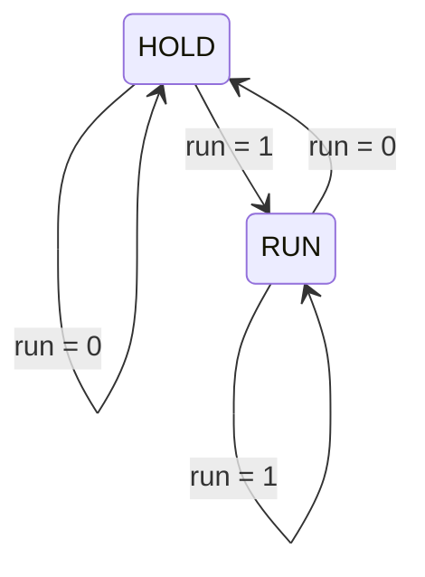
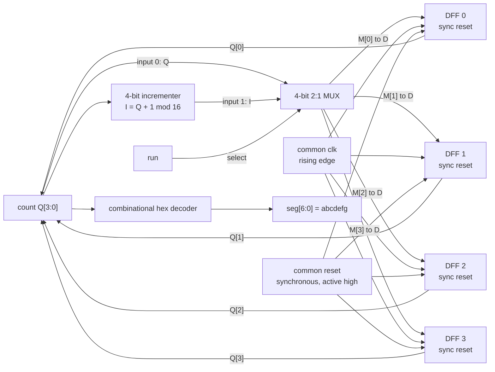

# Problem 2: 4-bit Run/Hold counter with hexadecimal display

**Team:** Saameer, Aniketh, Akash, Karishma
**Source:** `DLCD-LEVEL-2-PROBLEM.docx`, Problem 2 only.

## Requirements and interface

Build a 4-bit counter from an incrementer, a run-controlled 2:1 MUX, and four D flip-flops. Show its stored value as one hexadecimal digit on an active-high, common-cathode seven-segment display. Provide Verilog, a testbench, and simulation output for the lab demonstration.

| Signal | Direction | Meaning |
|---|---|---|
| `clk` | Input | Count changes only at a rising edge |
| `reset` | Input | Synchronous, active-high clear; highest priority |
| `run` | Input | 1 selects increment; 0 selects feedback/hold |
| `count[3:0]` | Output | Stored unsigned count, 0 to 15 |
| `seg[6:0]` | Output | `{a,b,c,d,e,f,g}`; 1 lights a segment |

There is no specified startup count before a rising edge samples `reset=1`.

## RUN/HOLD diagram and the Moore wording

The source calls this a two-state Moore FSM and also requires the current `run` input to select the count/count+1 MUX. The following is the requested **control-mode abstraction**, with all four arrows labeled. It is **not an additional stored mode register**.



| Previous control mode | `run` | Selected control mode | Action at next rising edge if reset=0 |
|---|---|---|---|
| HOLD | 0 | HOLD | Retain count |
| HOLD | 1 | RUN | Increment count |
| RUN | 0 | HOLD | Retain count |
| RUN | 1 | RUN | Increment count |

The implemented stored state is the 4-bit `count`, giving 16 possible states. Its outputs `count` and decoded `seg` depend only on that stored state, so the complete counter is Moore-style with respect to its outputs. RUN/HOLD alone is not a sufficient state description for the full machine: it does not identify the displayed count. A separately clocked mode register used to enable counting would sample `run`, then make the counter use the old mode on that same edge, introducing an unwanted cycle of delay. The design therefore implements the explicitly requested direct MUX selection with no delayed mode register. Reset clears count; it does not assign a stored RUN/HOLD mode.

## Next-count logic and priority

Let `Q=count` before the edge, `I=(Q+1) mod 16`, and `M=run ? I : Q`. Each flip-flop captures its corresponding `M` bit unless reset is asserted.

| `reset` | `run` | MUX output `M` | Count after the rising edge |
|---|---|---|---|
| 1 | X | Selection does not affect reset | `0000` |
| 0 | 0 | `Q` | `Q` (HOLD) |
| 0 | 1 | `(Q+1) mod 16` | `(Q+1) mod 16` (RUN) |

`X` in this table means either Boolean value, not an instruction to drive an unknown value.

For each bit `i`, the effective reset-qualified next-state equation is:

```text
Q_next[i] = reset ? 0 : (run ? I[i] : Q[i])
```

An incrementer can be derived directly from binary carry propagation:

```text
I[0] = ~Q[0]
I[1] = Q[1] XOR Q[0]
I[2] = Q[2] XOR (Q[1] AND Q[0])
I[3] = Q[3] XOR (Q[2] AND Q[1] AND Q[0])
```

## Datapath circuit

Each DFF below has a **synchronous** active-high reset input. The four instances share the same clock and reset. The 4-bit MUX is equivalent to four one-bit 2:1 MUXes with a common select.



**Synchronous reset:** raising reset between clock edges does not immediately clear the flip-flops. The next rising edge with reset high clears all four bits, even if `run=1`. The DFF sensitivity is `always @(posedge clk)`; reset is tested inside that block. Nonblocking assignment (`<=`) models edge-triggered storage.

**Modulo wrap:** only four sum bits are retained. Thus `1111 + 0001 = 1_0000`, whose low four bits are `0000`. There is no saturating stop at F.

## Seven-segment decoder

Segment positions, viewed from the front:

```text
       a
     -----
  f |     | b
    |  g  |
     -----
  e |     | c
    |     |
     -----
       d
```

Derive each row by choosing the segments that draw the glyph, then write 1 for each chosen segment in **a,b,c,d,e,f,g order**. The decimal point is outside this interface. Lowercase `b` and `d` distinguish them from `8` and `0`.

| Hex input | Input bits | Glyph | Lit segments | `seg[6:0]` (abcdefg) |
|---|---|---|---|---|
| 0 | 0000 | 0 | a b c d e f | `1111110` |
| 1 | 0001 | 1 | b c | `0110000` |
| 2 | 0010 | 2 | a b d e g | `1101101` |
| 3 | 0011 | 3 | a b c d g | `1111001` |
| 4 | 0100 | 4 | b c f g | `0110011` |
| 5 | 0101 | 5 | a c d f g | `1011011` |
| 6 | 0110 | 6 | a c d e f g | `1011111` |
| 7 | 0111 | 7 | a b c | `1110000` |
| 8 | 1000 | 8 | a b c d e f g | `1111111` |
| 9 | 1001 | 9 | a b c d f g | `1111011` |
| A | 1010 | A | a b c e f g | `1110111` |
| B | 1011 | b | c d e f g | `0011111` |
| C | 1100 | C | a d e f | `1001110` |
| D | 1101 | d | b c d e g | `0111101` |
| E | 1110 | E | a d e f g | `1001111` |
| F | 1111 | F | a e f g | `1000111` |

The decoder is combinational: it has no clock and stores no digit. A complete `always @(*)` assignment for all input values, including a default for unknown simulation inputs, prevents unintended latches. The default does not add a seventeenth hexadecimal digit.

## Suggested lab demonstration

Set inputs away from rising edges and inspect outputs after the edge has settled. This sequence describes expected behavior; it is not a claim that a particular simulation has passed.

1. Start a clock. Assert `reset=1` with `run=1`. At the next rising edge, expect count=0 and `seg=1111110`, proving reset priority.
2. Release reset and set `run=0`. Across several rising edges, expect 0 to remain displayed.
3. Set `run=1`. The very next rising edge gives 1, followed by 2 and 3.
4. Set `run=0` at count=3. Several edges retain 3 and `seg=1111001`.
5. Resume run. The next edge gives 4; continue through 9, A, b, C, d, E, F, then 0. Check all 16 decoder patterns against the table.
6. Assert reset between edges at a nonzero count. Before the next rising edge count remains unchanged; at that edge it becomes 0. Repeat with run both low and high.

In a waveform, show `clk`, `reset`, `run`, `count[3:0]`, and `seg[6:0]`. Display count in hexadecimal. Check immediately before and after a run change to show there is no extra enable cycle. Use the actual testbench report and waveform as evidence of execution.

## Viva preparation

| Question | Answer |
|---|---|
| Why four flip-flops? | Four stored bits encode 16 values. One DFF stores one bit. |
| What causes HOLD? | The MUX feeds Q back to D; the clock still reaches every DFF. |
| Why not gate the clock with run? | The specified design selects data through a MUX and uses one common clock. |
| What happens when reset and run are both 1? | Reset wins at the rising edge; count becomes 0. |
| Is reset asynchronous? | No. It is sampled only at a rising edge. |
| Does changing run immediately change count? | No. It changes the selected D data; Q changes at the next rising edge. |
| Does seg depend directly on run? | No. It is a combinational function of stored count only. |
| Is the RUN/HOLD diagram a separately implemented two-state register? | No. It abstracts the selected action. The 16-value count is the stored state; a separate enable register would add delay. |
| Why use b and d? | Their lowercase seven-segment glyphs are easier to distinguish from 8 and 0. |
| What is the bit order? | seg[6]=a through seg[0]=g; 1 means lit for common cathode. |
| Why use `<=` in the DFF? | Nonblocking assignments update clocked storage together after evaluation of the edge. |
| Why use `always @(*)` for the decoder? | It reacts to combinational inputs; assigning every path avoids a latch. |
| What is the initial count? | Unspecified until synchronous reset is sampled; simulation may show X before that. |
| Why does F become 0? | A four-bit result discards the carry from 15+1, implementing modulo 16. |

The reference MUX, synchronous-reset DFF, ripple-adder, and decoder examples under `DLCD/` were read for coding style. They remain read-only; this design uses its own modules and the interface fixed in `DESIGN.md`.

## Source organization

| File | Role |
|---|---|
| `counter4_run_hold.v` | Incrementer, explicit 4-bit MUX, and four explicit synchronous-reset DFF instances |
| `hex7seg.v` | Combinational 16-entry hexadecimal decoder |
| `level2_top.v` | Connects the counter output to the decoder using named ports |
| `tb_level2.v` | Checks behavior and generates simulation evidence |

The reset connections in the datapath drawing are to synchronous reset logic **inside each DFF**, not asynchronous clear pins. Run the supplied simulation script, then open its generated VCD in GTKWave to inspect the demonstration signals.
